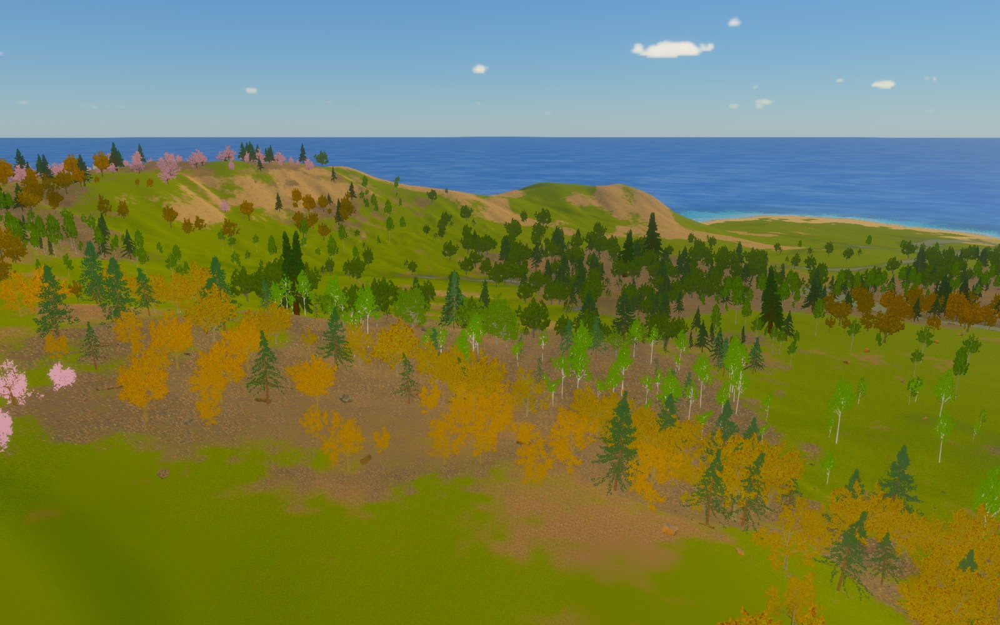
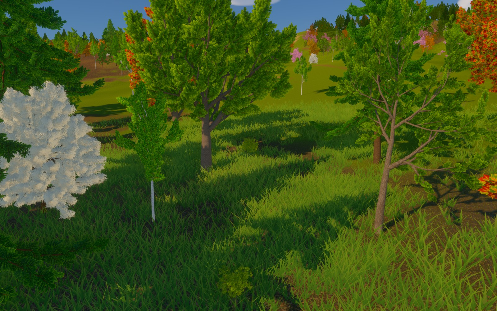
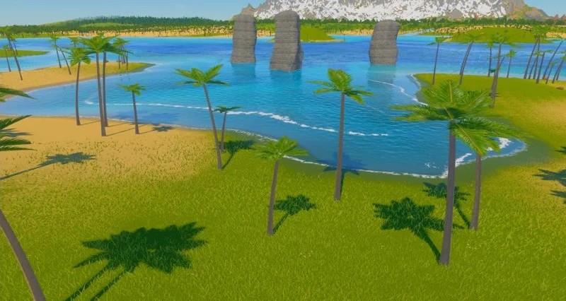
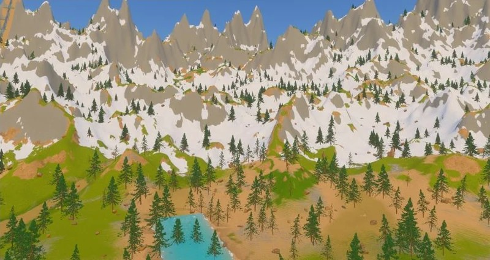
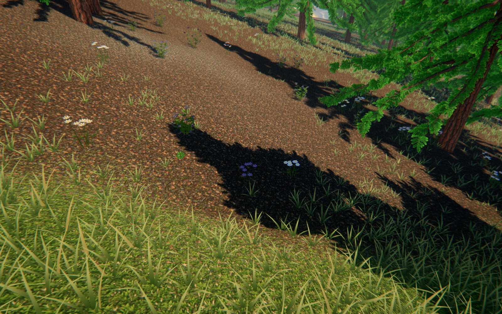
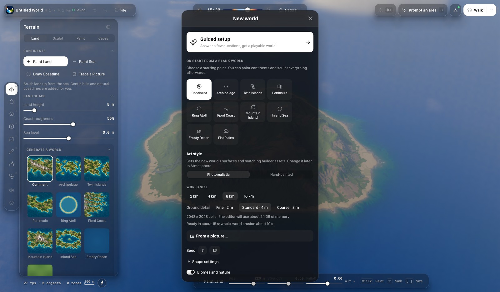

# Skyfold Studio

A free, open-source world builder for creating and exploring 3D worlds. Built with Rust and Bevy.

**[Download for macOS](https://github.com/holokat/skyfold-studio/releases/latest/download/Skyfold-Studio-macOS.dmg)** · [Website](https://skyfoldstudio.com) · [Marketplace](https://skyfoldstudio.com/marketplace.html)

Apple silicon preview. Open the DMG, drag Skyfold Studio into Applications, and start building.

Sculpt terrain, paint biomes, grow forests, shape rivers, build caves and dungeons, and walk through your world. Choose photorealistic or hand-painted styles. Connect an AI agent through MCP, or use the editor directly. Export to Godot, Unity, Unreal Engine or a generic scene bundle.

| Hand-painted forests (optional pack) | Coastlines and water |
| --- | --- |
|  |  |
| Alpine landscapes | Flowers and ground cover |
|  |  |

The marketplace is open to creators. Anyone can publish free assets and packs; paid selling is not enabled in production yet. Paid marketplace assets are distributed separately and are **not included** in this repository or the app download.

The source code is **MIT licensed**. See [building from source](docs/building.md) and [third-party notices](THIRD_PARTY_NOTICES.md). Downloading the app requires no icon license or developer setup.
