<div align="center">


# Skyfold Studio

**Create entire MMO worlds in seconds.**

Generate the landscape, let your agent sculpt it, and step inside what you create.<br>
A free, open-source world builder for macOS, written in Rust on Bevy.

[**Download for macOS**](https://github.com/holokat/skyfold-studio/releases/latest/download/Skyfold-Studio-macOS.dmg) · [Website](https://skyfoldstudio.com) · [Marketplace](https://skyfoldstudio.com/marketplace) · [Build from source](docs/building.md)

[](LICENSE)


<a href="https://skyfoldstudio.com"></a>

<sub>Watch it with sound on <a href="https://skyfoldstudio.com">skyfoldstudio.com</a>.</sub>

</div>

---

## Hundreds of hours. Or a few seconds.

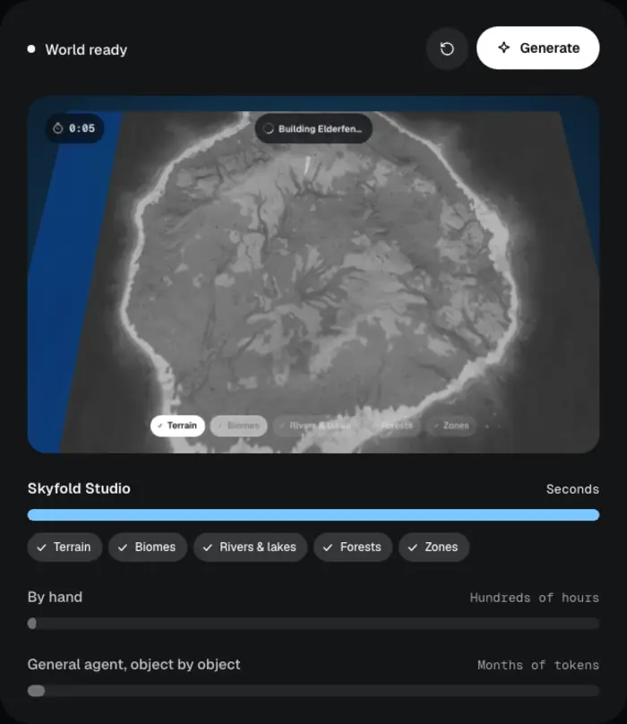

Sculpting terrain, painting biomes and placing every tree by hand takes hundreds of hours. Asking a general-purpose agent to build a world object by object burns through months of tokens.

**Skyfold generates the whole world first, then your agent edits it.** Pick a shape, a size and a climate and you get terrain, biomes, rivers, lakes, forests and level zones in about 20 seconds. Everything after that is yours to change.

<br clear="right">

## Agent-first, by design.

Skyfold is built **agent-first**. Every feature in the editor is also an [MCP](https://modelcontextprotocol.io) tool: more than 240 of them, covering terrain, nature, water, roads, objects, caves, dungeons, zones, gameplay, lighting, analysis and export. Your agent never draws a single triangle. It reads the world, decides what to do, and calls the same code the editor's own buttons call.

<p align="center">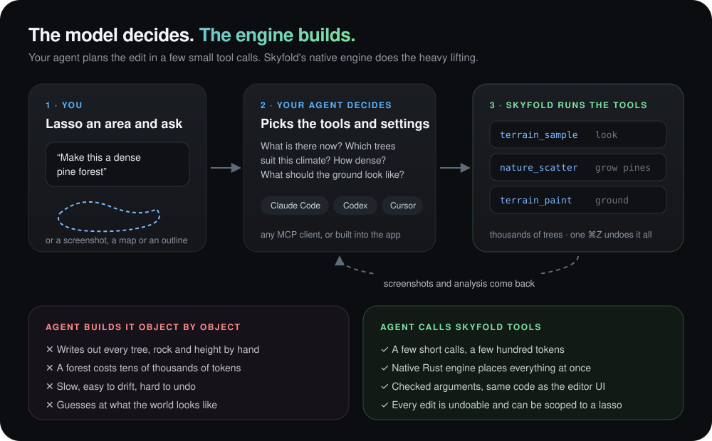</p>

This split plays to each side's strengths. **Language models are good at intent:** turning “a dense, old pine forest on the north slope” into a plan. **Engines are good at volume and precision:** placing eighteen thousand trees that follow the slope, avoid the river and match the climate. One tool call carries the plan:

```json
{
  "tool": "nature_scatter",
  "args": {
    "area": { "polygon": [[412, -88], [530, -40], [575, 96], [446, 140], [380, 30]] },
    "preset": "pine_forest",
    "density": 1.4
  }
}
```

That's around fifty tokens, and the engine turns it into thousands of placed trees. A general agent writing the same forest object by object would spend tens of thousands of tokens and still not know where the slopes are.

What you get from working this way:

| Benefit | Why it matters |
| --- | --- |
| 🪙 **Tiny token bills** | The agent sends short plans; the engine does the volume. A whole region costs a few calls, not a transcript of coordinates. |
| ⚡ **Native speed** | Tools run inside the editor's Rust engine between frames, at the speed of a brush stroke. |
| 🎯 **Exact and consistent** | Every argument is checked against a JSON schema before anything runs, and each tool reuses the editor's own code paths. Agent edits look exactly like hand edits. |
| ↩️ **Always undoable** | Each call is one undo step. `batch` groups many calls into one step, and `atomic` rolls the whole batch back if any call fails. |
| 🧭 **Scoped to what you choose** | Lasso an area, turn on *Mask edits to selection*, and the agent's changes stay inside the line. |
| 👀 **The agent can see** | `screenshot`, `terrain_sample`, `world_info` and the `analyze_*` tools return pictures, height and biome maps and walkability, so the agent checks its own work and fixes it. |
| 🔌 **Bring any agent** | Claude Code, Codex, Claude Desktop, Cursor, VS Code or any MCP client. Inside the app, *Prompt an area* runs on Codex (ChatGPT sign-in), Claude Code or your own Anthropic API key. |
| 📈 **Gets better with every model** | The engine stays the same while models keep improving. Smarter models make better plans with the same tools. |

## Edit worlds with your agent.

Start with a prompt, a screenshot or an outline. Shape the result with Skyfold's worldbuilding tools.

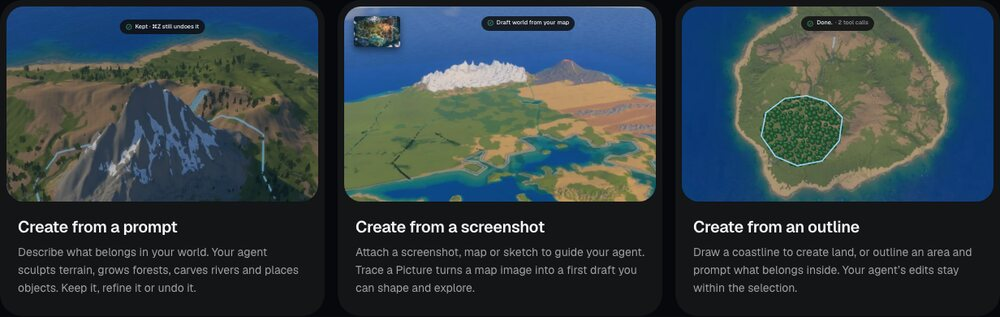

### A prompt becomes a place.

Lasso a patch of the world and tell your agent what belongs there. Keep it, refine it, or undo it.

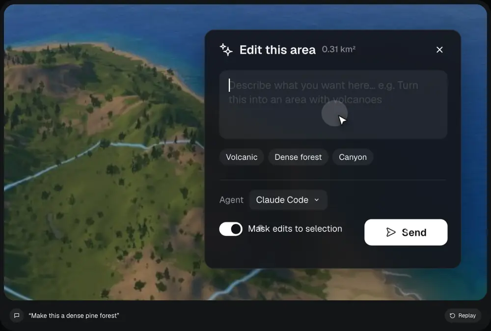

## From first click to your first zone.

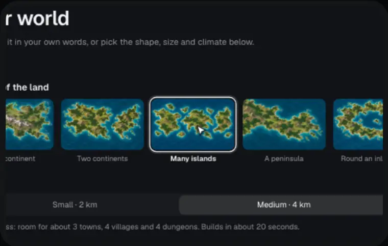

Choose a shape and a climate. Spawn an island, a continent or an archipelago with terrain, biomes and nature already in place.

Start with a 2–16 km world, then paint named zones, set level ranges and give each region its own weather, audio and mood. Guided setup adds a capital, towns, villages and the roads between them, and makes up names from the land if you leave them empty.

<br clear="right">

## Start with an image. End up in a world.

Upload a map, sketch or concept image. **Trace a Picture** reads its coastline, regions, lakes and rivers and turns them into a draft world you can shape and explore. Undo goes back in one step.

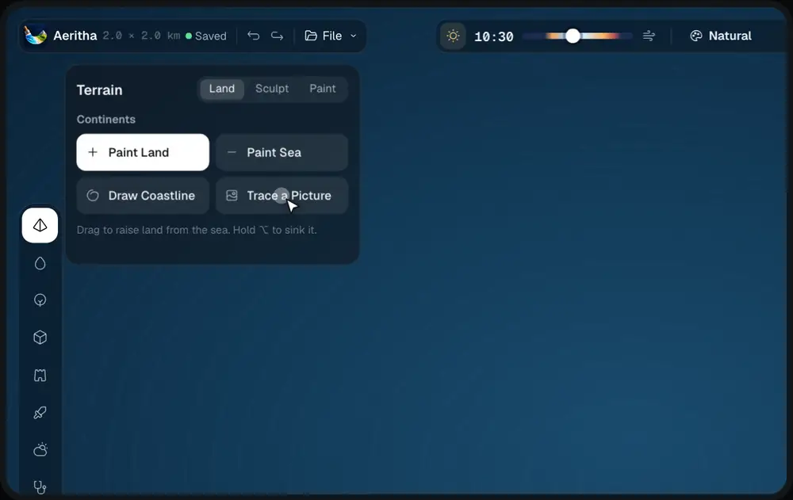

## Same world. A different atmosphere.

Switch styles without rebuilding the landscape, and tune the strength to make it yours: Natural, Nordic Mist, Cinematic, Golden Hour, Golden Vintage, Hellfire Dusk and more. Choose a photorealistic world or a hand-painted one.

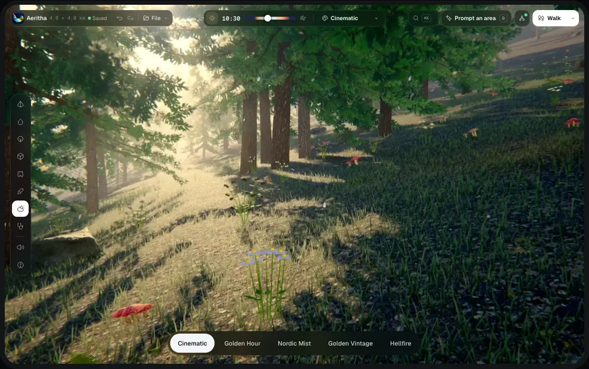

## Step into what you just created.

Come down from the editor and explore at player height. Walk, run, jump, swim or fly. Record a route and feel how the world plays.

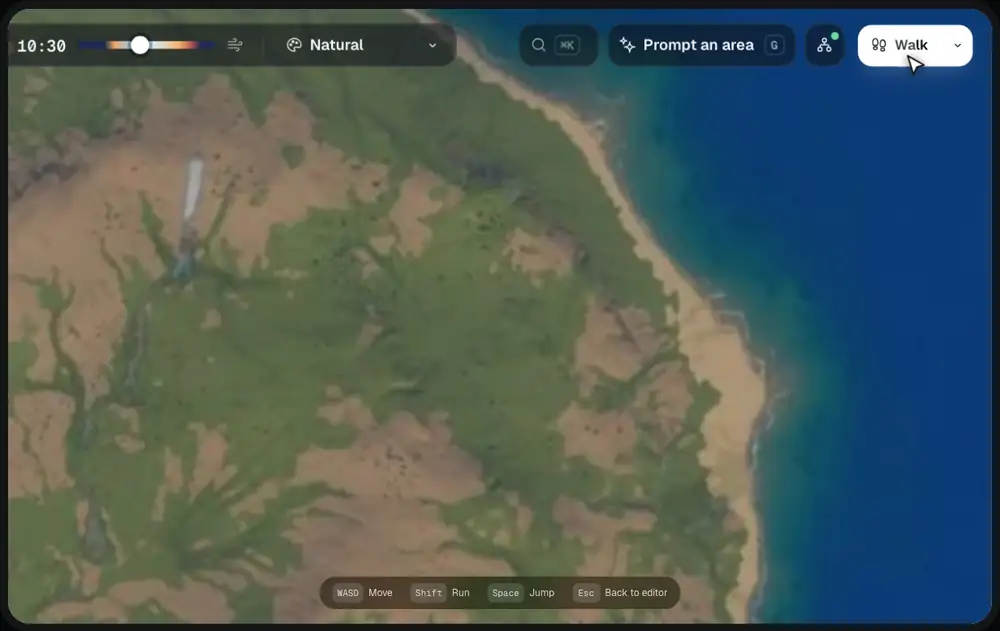

## Find the dead zones before your players do.

**World analysis** highlights content gaps, walkability, travel time, level flow and reachability. **World Doctor** finds floating objects, drowned plants, unreachable places and steep roads, then jumps you to the fix. Your agent can run every check too.

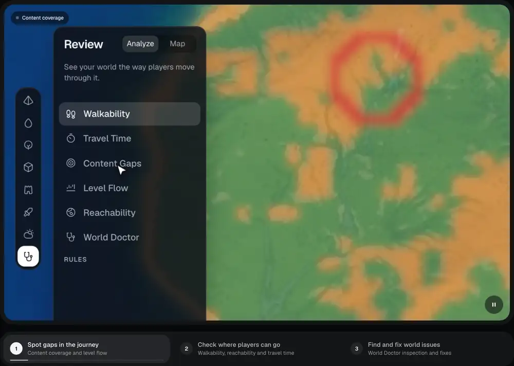

## Take it to your favorite game engine.

Export terrain, models, instances, water, roads, lighting and gameplay data with dedicated workflows.

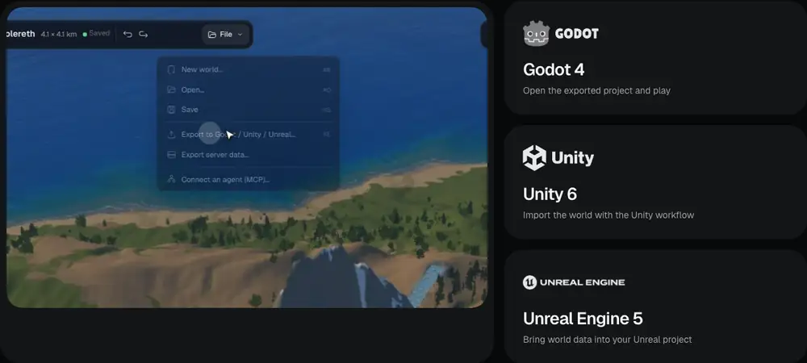

| Target | What you get |
| --- | --- |
| **Godot 4** | A complete Godot 4.3+ project: open `project.godot` and press F5 to fly or walk around. |
| **Unity 6** | An importer that builds the terrain and its layers, instances, water, sky, haze, colour grade and a fly camera. |
| **Unreal Engine 5** | Landscape heightmap and weightmaps, GLB models, water and roads, plus an editor script (UE 5.4+) that imports and places everything and sets up sky, fog and lighting. |
| **Generic** | Heightmap, splat maps, layer textures, GLB models, instance lists, water, roads, gameplay and lighting as plain files with a manifest, for any engine or tool. |

Server data (zones, spawns, resource nodes, NPCs) exports separately for your game backend.

## The pieces for your next world.

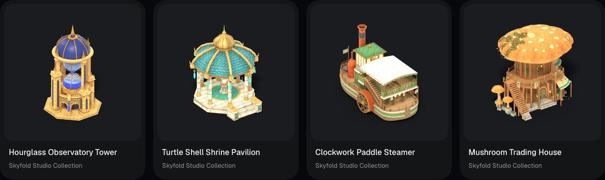

Browse the [Skyfold marketplace](https://skyfoldstudio.com/marketplace) for forests, fish, villages and props. Creators can make a profile and share their own models or packs. Marketplace assets are distributed separately and are **not included** in this repository or the app download.

## More from the editor

| Hand-painted forests (optional pack) | Coastlines and water |
| --- | --- |
|  |  |
| **Alpine landscapes** | **Flowers and ground cover** |
|  |  |

## Connect your agent

Turn on the MCP server in the app (**File › Connect an agent (MCP)…**), then copy your client's setup from that dialog. Every request needs your editor's private key (made on first launch, kept in `worlds/.mcp_key`); the dialog fills it in.

**Claude Code**

```sh
claude mcp add --transport http world-builder http://127.0.0.1:7740/mcp --header "Authorization: Bearer <key from the dialog>"
```

**Cursor, VS Code and other Streamable HTTP clients**

```json
{ "mcpServers": { "world-builder": { "url": "http://127.0.0.1:7740/mcp", "headers": { "Authorization": "Bearer <key from the dialog>" } } } }
```

**Claude Desktop** uses the `--mcp-stdio` command shown in the same dialog, which also starts the editor if it isn't running.

Then just ask: *“Make a volcanic island with a harbour town on the east coast, then check where players can't walk.”*

## Build from source

Skyfold Studio is a Rust workspace. See [docs/building.md](docs/building.md) for the toolchain, dependencies and run instructions.

## License

The Skyfold Studio source code is free and open source under the [MIT License](LICENSE): use it, change it and share it, including commercially.

That covers this code only. Assets, packs and worlds made by creators belong to them and come with their own licenses; marketplace assets are not part of this repository. Third-party components are listed in [THIRD_PARTY_NOTICES.md](THIRD_PARTY_NOTICES.md).
